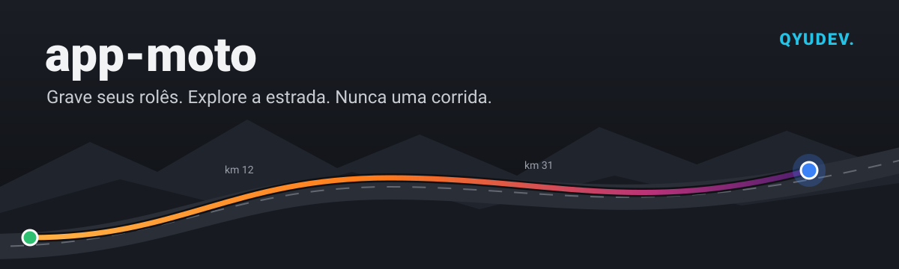

  

**O diário de estrada do motociclista.**
Grave seus rolês pelo GPS, veja o mapa ao vivo, junte bandeiras e pins, e descubra estradas novas: tudo funcionando até sem sinal.

*Nome oficial em breve. Feito por **QyuDev**.*

---

## 🧭 O que é

Um app para quem gosta de rodar de moto e quer guardar a história de cada passeio: o caminho, as cidades, os estados, as divisas cruzadas e as conquistas pelo Brasil e pela América do Sul.

Aqui **ninguém compete por velocidade**. As conquistas são por **explorar**: quilômetros, lugares novos, constância e estrada com a turma. O app não mostra velocidade em lugar nenhum.

> Este repositório tem só a **versão web publicada** (o site). O código-fonte do app é **privado**.

---

## ✨ O que dá para fazer

### 🛰️ Gravar o rolê
- Grava o caminho pelo GPS, com a tela ligada ou no bolso
- Mapa ao vivo, números grandes para o guidão e pausa automática nas paradas
- **Funciona sem internet**: grava e guarda no celular, e manda para a nuvem quando o sinal voltar
- **Mapas sem internet**: baixe a região antes de viajar e o mapa aparece mesmo no meio do sertão
- Viagem de vários dias, com cada dia separado e o resumo da viagem inteira
- Exporta o rolê em **GPX**, para levar para onde quiser

### 🗺️ Explorar
- **Mapa de calor** com todas as estradas que você já rodou
- **Passaporte** dos estados e das divisas cruzadas
- **Cidades do rolê**: o app descobre sozinho as cidades por onde você passou, entre as mais de 5.500 do Brasil
- **Rodovia de ponta a ponta**: BR-116, BR-101, Transamazônica, Belém–Brasília e outras
- **Trechos**: o caminho entre duas cidades, com o **Fiel da estrada** (quem mais passou) e o **Pioneiro** (o primeiro a passar). Conta vezes, nunca tempo
- **Pontos da comunidade**: posto, borracharia, parada boa e avisos da estrada
- **Seu mês na estrada** e a **retrospectiva do ano**, prontos para mandar no WhatsApp

### 🎖️ Conquistas
- Mais de **160 pins** em mais de 20 categorias, desenhados como moedas de metal: bronze, prata, ouro e lendário
- Os estados e os países vêm com a bandeira, e cada pin mostra a raridade, ou seja, quantos pilotos têm
- O colete no perfil mostra os seus pins favoritos

### 👥 Com a turma
- Feed com os rolês de quem você segue, com o mapa, as fotos e as bandeiras de onde passou
- Curtidas, comentários e clubes, com rolês marcados e confirmação de presença
- Garagem com as suas motos e o hodômetro de cada uma

---

## 🔒 Privacidade em primeiro lugar

- Você escolhe quem vê: perfil aberto, só amigos ou fechado, e o rolê "só eu"
- **Zonas de casa e trabalho**: o começo e o fim do caminho são cortados e a cidade de casa fica escondida
- Dá para esconder o mapa, a hora ou o tempo de qualquer rolê
- Antes de subir, as fotos perdem a localização que vem escondida no arquivo
- **Sem anúncios e sem venda de dados**
- Pela LGPD, você pode **baixar todos os seus dados** e **apagar a conta** quando quiser, dentro do app

📄 [Política de privacidade](https://jacobbv.github.io/app-moto-web/politica)

---

## 📱 Onde usar

| | |
|---|---|
| 🌐 **Navegador** | [jacobbv.github.io/app-moto-web](https://jacobbv.github.io/app-moto-web/), no computador ou no celular |
| 🤖 **Android** | Em breve no Google Play (em testes fechados) |
| 🍎 **iPhone** | Em breve |

Algumas funções, como os mapas sem internet e a gravação com a tela desligada, são só do app do celular.

---

## 🙏 Créditos

O app usa serviços e bibliotecas abertas. Obrigado a todos que mantêm esses projetos:

| O quê | Para quê | Licença |
|---|---|---|
| [OpenStreetMap](https://www.openstreetmap.org/copyright) | Dados do mapa | ODbL 1.0, © colaboradores do OpenStreetMap |
| [OpenMapTiles](https://openmaptiles.org) | Organização dos dados do mapa | BSD + CC-BY |
| [OpenFreeMap](https://openfreemap.org) | Servidor e estilos do mapa | MIT |
| [MapLibre GL JS](https://maplibre.org) | Desenho do mapa | BSD-3-Clause |
| [Esri World Imagery](https://www.esri.com) | Mapa satélite | Termos de uso da Esri |
| [Natural Earth](https://www.naturalearthdata.com) | Contornos de países e estados | Domínio público |
| [IBGE](https://www.ibge.gov.br), pelo [geodata-br](https://github.com/tbrugz/geodata-br) | Contornos das cidades | CC0 1.0 |
| [flag-icons](https://github.com/lipis/flag-icons) | Bandeiras dos países | MIT |
| Bandeiras dos estados | Símbolos oficiais | Sem direitos autorais (Lei 9.610/1998, art. 8º, IV) |
| [React](https://react.dev), [React Native](https://reactnative.dev) e [Expo](https://expo.dev) | Base do app | MIT |
| [Material Design Icons](https://pictogrammers.com/library/mdi/) | Ícones | Apache 2.0 |
| [Supabase](https://supabase.com) | Nuvem (contas, banco e fotos) | MIT (supabase-js) |
| [GitHub Pages](https://pages.github.com) | Hospedagem deste site | Termos de Serviço do GitHub |

A lista completa, com todas as bibliotecas e licenças, fica na tela **Créditos e licenças**, dentro do app.

---

## 📬 Contato

  
  
  

Dúvidas, sugestões ou quer entrar nos testes? Manda um e-mail.

---

© 2026 **QyuDev** (Rameson Jacó). **Todos os direitos reservados.**
O app, o nome, o visual, os desenhos dos pins e o código são de propriedade da QyuDev. Veja o arquivo [LICENSE](LICENSE).

  

Feito no sertão da Paraíba, sobre duas rodas. 
<b>QYUDEV.</b>

